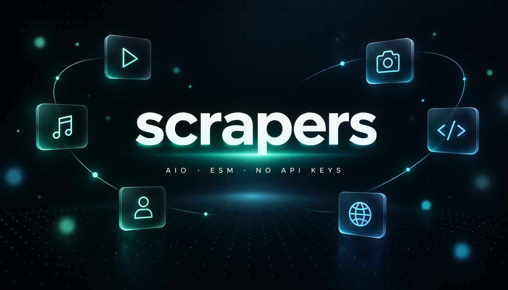

<p align="center">
  
</p>

<h1 align="center">scrapers</h1>

<p align="center">
  <a href="https://www.npmjs.com/package/scrapers"></a>
  = 18">
  
  
  
</p>

<p align="center">
All-in-one scrapers for social media, media downloads, search and public profiles.<br>
Plain JavaScript, zero API keys, one dependency layer (axios + cheerio).
</p>

<p align="center">


</p>

## Install

```bash
npm install scrapers
```

Requires Node.js 18 or newer.

## Quick start

```js
import { Scraper } from 'scrapers';

const s = new Scraper();

await s.Download.tiktok('https://www.tiktok.com/@user/video/123');
await s.Search.youtube('lofi');
await s.Search.weather('Jakarta');
await s.Stalks.github('torvalds');
```

Import only one group when that is all you need:

```js
import { tiktok, instagram, facebook } from 'scrapers/Download';
import { youtube, web, weather } from 'scrapers/Search';
import { github, steam, telegram } from 'scrapers/Stalks';
```

## API

### Download

| Function | Input | Returns |
|----------|-------|---------|
| `tiktok` | TikTok video URL | title, cover, duration, video/audio URLs |
| `twitter` | X/Twitter status URL | text, author, media, created date |
| `mediafire` | MediaFire file URL | file name, size, direct link |
| `reddit` | Reddit post URL or ID | post metadata plus image, gallery or video media |
| `pinterest` | Pinterest pin URL | title, description, image, video |
| `spotify` | Spotify track or episode URL | metadata plus 30-second preview |
| `soundcloud` | SoundCloud track URL | metadata, artwork, progressive MP3 or HLS |
| `dailymotion` | Dailymotion video URL | metadata, HLS and MP4 when offered |
| `instagram` | Instagram post, reel or TV URL | media items with type, filename, URL and thumbnail |
| `facebook` | Facebook video or watch URL | HD and SD video URLs |

### Search

| Function | Input | Returns |
|----------|-------|---------|
| `web` | query | Bing results: title, URL, snippet |
| `youtube` | query | video ID, URL, title, duration, views, channel, thumbnail |
| `wikipedia` | query, language, limit | title, URL, summary, thumbnail |
| `npm` | query, limit | package name, version, description, author, keywords |
| `github` | query, limit | repository name, URL, description, stars, language |
| `lyrics` | song query, limit | title, artist, album, duration, lyrics |
| `news` | query, limit | title, source, URL, published date |
| `stackoverflow` | query, limit | question title, URL, score, answers, tags |
| `dictionary` | word | phonetics, audio, meanings, examples |
| `books` | query, limit | title, authors, year, editions, languages, cover |
| `movies` | query, limit | IMDb ID, title, year, type, rank, stars, poster |
| `weather` | place | location, current conditions, hourly and daily forecast |

### Stalks

| Function | Input | Returns |
|----------|-------|---------|
| `github` | username | name, bio, avatar, company, location, repos, followers |
| `npm` | package name | latest version, maintainers, dependencies, weekly downloads |
| `tiktok` | username | nickname, bio, avatar, followers, following, likes, videos |
| `twitter` | username | name, bio, avatar, banner, followers, following, tweets |
| `ip` | IP or empty for own | country, region, city, coordinates, timezone, ISP |
| `steam` | vanity name or SteamID | persona, state, privacy, avatar, level, games, playtime |
| `telegram` | channel username | title, description, subscribers, photo |
| `gitlab` | username | name, state, avatar, public profile fields |
| `hackernews` | username | about, karma, created date, submissions |
| `instagram` | username or profile URL | name, bio, avatar, followers, following, posts, badges |
| `facebook` | page name or URL | name, followers, talking about, about, avatar |

## Response example

```js
const post = await s.Download.instagram('https://www.instagram.com/p/Deo2TSKl1b-/');

{
  url: 'https://www.instagram.com/p/Deo2TSKl1b-',
  items: [
    {
      type: 'image',
      filename: 'downloadgram.org_855210719_18631625542020096_981380093287766277_n.jpg',
      url: 'https://scontent.cdninstagram.com/...',
      thumbnail: 'https://cdn.downloadgram.org/?token=...'
    }
  ]
}
```

## Error handling

Every failure is a `ScraperError` with the scraper name and the HTTP status in the message.

```js
import { Scraper, ScraperError } from 'scrapers';

const s = new Scraper();

try {
    await s.Download.reddit('https://www.reddit.com/r/aww/comments/1xkax7x/');
} catch (err) {
    if (err instanceof ScraperError) console.error(err.message);
}
```

## Notes

- GitHub API rate limits: set `GITHUB_TOKEN` to lift them.
- Spotify returns metadata plus the 30-second preview; the full track is not downloadable.
- SoundCloud prefers a progressive MP3 and falls back to an HLS playlist.
- Dailymotion returns HLS and MP4 when the player exposes both.
- Instagram download uses Downloadgram and works for public posts and reels.
- Facebook download reads the public video embed and returns HD/SD URLs.
- Reddit reads the public Arctic Shift archive, no login or API key.
- Private accounts, removed posts and geo-blocked content are not accessible.
- Third-party endpoints change over time. When one changes, the scraper fails loudly with the HTTP status.

## Legal

Scrape only public content you have the right to access. Respect each platform's terms of service, robots policy and local law. Do not use this package to redistribute copyrighted media.

## License

MIT